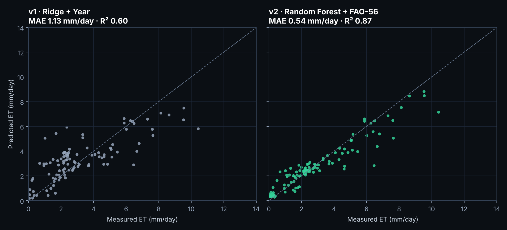
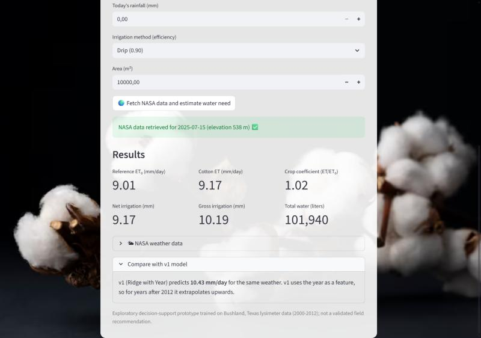

# Cotton Water Estimator

Daily cotton evapotranspiration model trained on USDA lysimeter data, served through Streamlit apps that pull live NASA POWER weather.

Built during the **UN & Samsung Innovation Campus** programme and later improved. Portfolio page:
[ezgiportfolio.vercel.app/cotton-estimator](https://ezgiportfolio.vercel.app/cotton-estimator)



## Results

Same 80/20 test split (114 days, `random_state=42`) for both models:

| Evaluation | v1 · Ridge + Year | **v2 · Random Forest + FAO-56** |
|---|---|---|
| Test split, MAE / R² | 1.13 mm/day / 0.60 | **0.54 mm/day / 0.87** |
| 5-fold cross-validation, MAE / R² | 1.14 / 0.64 | **0.63 / 0.87** |
| Leave-one-season-out (water-limited seasons), R² | 0.13 | **0.29** |

v2 halves the error. Predicting a completely unseen season is still the hardest case; more seasons and sites are needed.

## Pipeline

```
raw daily records (1,463)  →  script/      decimal commas → dots, drop incomplete rows
                           →  final.xlsx   570 complete days, 2000 / 2001 / 2008 / 2012
                           →  model_v2/    FAO-56 features + Random Forest
NASA POWER (lat, lon, date) →  app_v2.py    ET → net / gross irrigation (mm) → liters
```

Irrigation efficiencies used by the apps: drip 0.90, sprinkler 0.75, flood 0.60. Details: [dataset card](datasetcard.md) · [model card](modelcard.md).

| Input form | Results |
|---|---|
|  |  |

*`app_v2.py` with lat 37.159, lon 39.004, 2025-07-15, full irrigation, drip, 10,000 m² → ET₀ 9.01, ET 9.17 mm/day, gross 10.19 mm, 101,940 L.*

## Model changes (v1 → v2)

| | v1 `model_xgboost/train4.py` | v2 `model_v2/train_v2.py` |
|---|---|---|
| Algorithm | StandardScaler + Ridge | Random Forest, 400 trees |
| `Year` feature | used | dropped |
| Physics features | – | FAO-56 ET₀, vapour pressure deficit |
| Water regime | – | full vs. limited irrigation flag |
| Evaluation | one 80/20 split | 80/20 split + 5-fold CV + leave-one-season-out |

Why `Year` was dropped: holding every weather input fixed, v1 returns 3.5 mm/day for year 2000, 7.2 for 2012 and 11.2 for 2025. The coefficient was absorbing season-level differences in water supply, so any post-2012 date was extrapolated. In v2 that signal is modelled explicitly by the water-regime flag (seasonal ET/ET₀: 2012 = 0.82, 2000/2001/2008 = 0.34–0.46).

## Repository structure

```
script/          data cleaning (decimal commas → dots, drop incomplete rows) → final.xlsx
model_xgboost/   v1 training scripts (train.py … train4.py) and the cleaned dataset
                 (folder name kept from development; the models are Ridge, not XGBoost)
demoweb/         first apps with manual weather input (ET estimate, irrigation calculator)
apiconnect/      v1 apps with NASA POWER weather (sonhal.py is the latest)
model_v2/        v2: FAO-56 features, training/evaluation, improved NASA helper, app_v2.py
docs/images/     screenshots and comparison chart
```

## Run

```bash
pip install -r requirements.txt

# v2 (recommended)
cd model_v2
python train_v2.py          # trains, evaluates v1 vs v2, saves the model and results/
streamlit run app_v2.py

# v1 app
cd apiconnect
streamlit run sonhal.py
```

## Limitations

- One site (Bushland, Texas) and four seasons; results for other regions are demonstrations of the workflow, not validated recommendations.
- The water-regime label is inferred from the measured ET/ET₀ ratio, not from field irrigation logs.
- NASA POWER does not provide net radiation; the apps approximate it as 0.75 × solar radiation. Rainfall is entered manually.

## Data and licence

Data: USDA-ARS Bushland, Texas Cotton Datasets (Ag Data Commons), released under **CC0 1.0** (public domain):
- *Weighing Lysimeter Data for The Bushland, Texas, Cotton Datasets* (weather variables and ET used by the model): https://doi.org/10.15482/USDA.ADC/25114670.v1
- *Growth and Yield Data for the Bushland, Texas, Cotton Datasets* (companion dataset used during data exploration)

Code: for academic and portfolio use.

## Author

Ezgi Öztürk · Computer Engineering, Düzce University · [GitHub](https://github.com/Ezgicode) · [Portfolio](https://ezgiportfolio.vercel.app)
