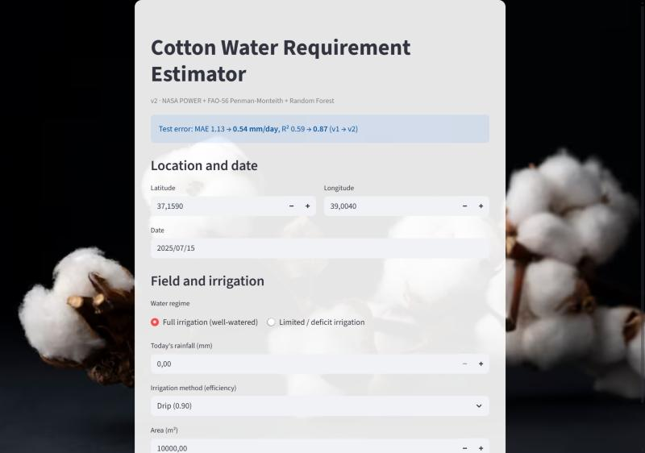

# Cotton Water Estimator

Predicting how much water a cotton field needs each day, from real field measurements and live weather data.

Built during the **UN & Samsung Innovation Campus** programme and later improved. Portfolio page:
[ezgiportfolio.vercel.app/cotton-estimator](https://ezgiportfolio.vercel.app/cotton-estimator)


## Results

Same 80/20 test split (114 days, `random_state=42`) for both models:

| Evaluation | v1 · Ridge + Year | **v2 · Random Forest + FAO-56** |
|---|---|---|
| Test split, MAE / R² | 1.13 mm/day / 0.60 | **0.54 mm/day / 0.87** |
| 5-fold cross-validation, MAE / R² | 1.14 / 0.64 | **0.63 / 0.87** |
| Leave-one-season-out (water-limited seasons), R² | 0.13 | **0.29** |

v2 halves the error. Predicting a completely unseen season is still the hardest case; more seasons and sites are needed.

## How it works

1. **Data:** daily cotton evapotranspiration (ET) and weather measurements from the USDA-ARS Bushland, Texas cotton datasets. 1,463 raw daily records were cleaned (decimal formats, missing values) into **570 complete days** from the 2000, 2001, 2008 and 2012 seasons. See the [dataset card](datasetcard.md).
2. **Model:** predicts daily cotton ET (mm/day) from temperature, humidity, solar and net radiation, wind speed and season. See the [model card](modelcard.md).
3. **App:** a Streamlit app fetches the day's weather for any latitude/longitude from the NASA POWER API, predicts ET and converts it into an irrigation depth and total liters for the field, using the chosen irrigation method's efficiency (drip 0.90, sprinkler 0.75, flood 0.60).

| Input form | Results |
|---|---|
|  |  |

*Demo run: 1 ha drip-irrigated field, Harran Plain (Şanlıurfa), 15 July 2025 → ET 9.17 mm/day, about 102,000 L.*

## From v1 to v2

**v1** (`model_xgboost/train4.py`) is a standardized Ridge regression on weather, day of year and **year**. Reviewing it later, I found the year acted as a shortcut: the four seasons differ mainly in water availability, so with identical weather v1 predicts 3.5 mm/day for 2000 and 11.2 mm/day for 2025.

**v2** (`model_v2/`):
- removes the year feature,
- adds FAO-56 Penman-Monteith reference ET₀ and vapour pressure deficit,
- adds a water-regime input (2012 behaves as well-watered, seasonal ET/ET₀ = 0.82; the other seasons as water-limited, 0.34–0.46),
- uses a Random Forest,
- and is evaluated with 5-fold CV and leave-one-season-out in addition to the original split.

## Repository structure

```
script/          data cleaning (decimal commas → dots, drop incomplete rows) → final.xlsx
model_xgboost/   v1 training scripts (train.py … train4.py) and the cleaned dataset
                 (folder name kept from development; the models are Ridge, not XGBoost)
demoweb/         first apps with manual weather input (ET estimate, irrigation calculator)
apiconnect/      v1 apps with NASA POWER weather (sonhal.py is the latest)
model_v2/        v2: FAO-56 features, training/evaluation, improved NASA helper, app_v2.py
docs/images/     screenshots and comparison chart
```

## Run

```bash
pip install -r requirements.txt

# v2 (recommended)
cd model_v2
python train_v2.py          # trains, evaluates v1 vs v2, saves the model and results/
streamlit run app_v2.py

# v1 app
cd apiconnect
streamlit run sonhal.py
```

## Limitations

- One site (Bushland, Texas) and four seasons; results for other regions are demonstrations of the workflow, not validated recommendations.
- The water-regime label is inferred from the measured ET/ET₀ ratio, not from field irrigation logs.
- NASA POWER does not provide net radiation; the apps approximate it as 0.75 × solar radiation. Rainfall is entered manually.

## Data and licence

Data: USDA-ARS Bushland, Texas Cotton Datasets (Ag Data Commons), released under **CC0 1.0** (public domain):
- *Weighing Lysimeter Data for The Bushland, Texas, Cotton Datasets* (weather variables and ET used by the model): https://doi.org/10.15482/USDA.ADC/25114670.v1
- *Growth and Yield Data for the Bushland, Texas, Cotton Datasets* (companion dataset used during data exploration)

Code: for academic and portfolio use.

## Author

Ezgi Öztürk · Computer Engineering, Düzce University · [GitHub](https://github.com/Ezgicode) · [Portfolio](https://ezgiportfolio.vercel.app)
